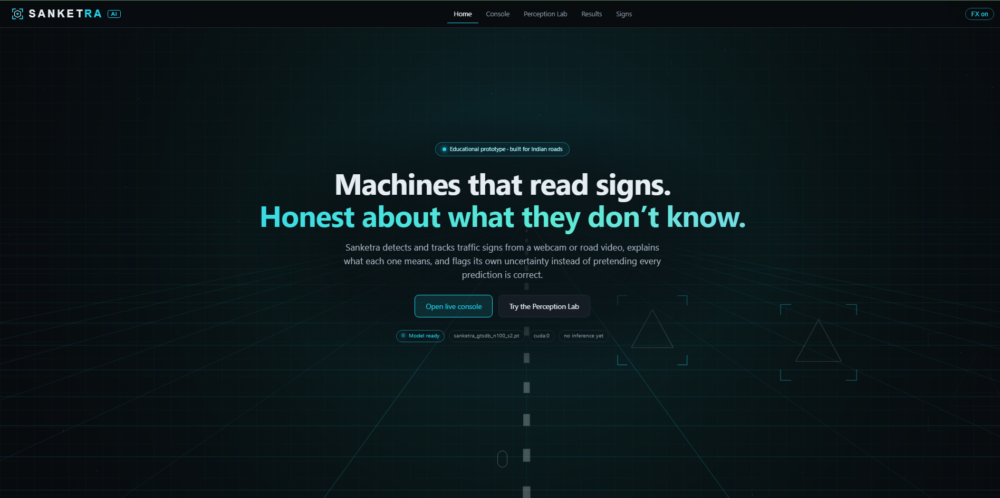
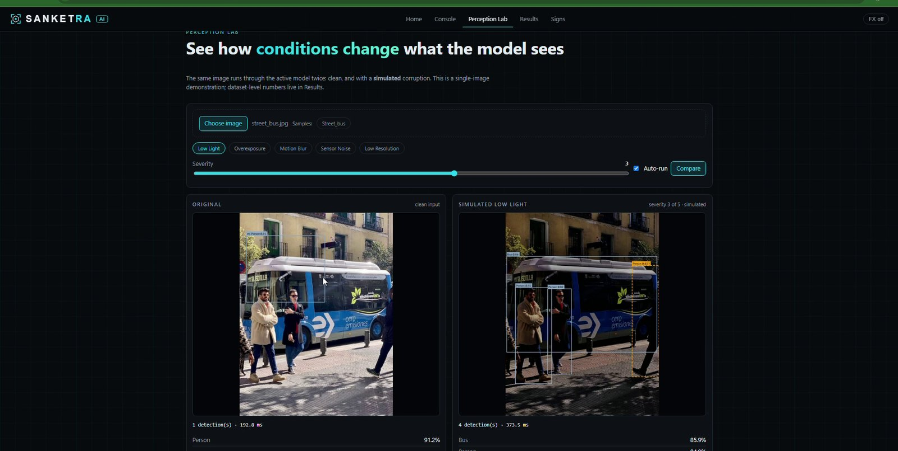
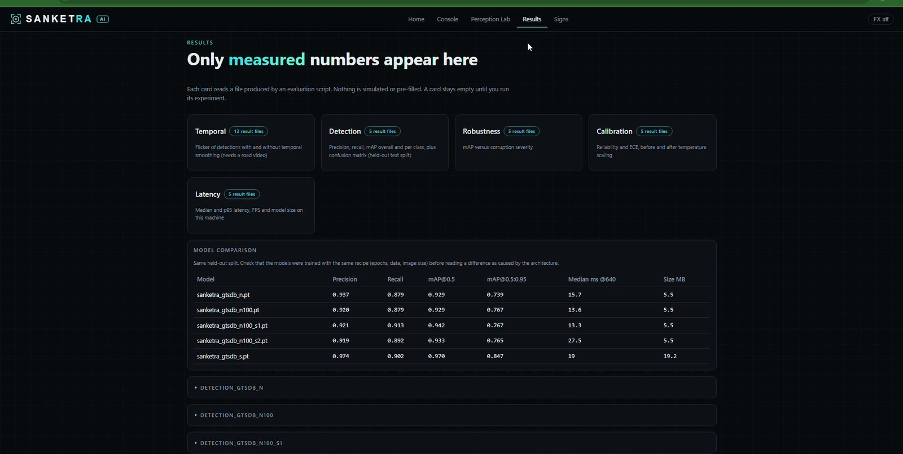

# SANKETRA

**Robustness-aware traffic-sign perception: live detection, tracking and honest uncertainty.**

  

SANKETRA (*sanket* = sign, *netra* = eye) is an educational research prototype. It detects traffic-sign **groups** (prohibitory, danger, mandatory, other) in live video or from a webcam, tracks them, shows how uncertain each prediction is, and measures how the detector degrades under bad conditions. Every number shown by the app comes from an evaluation script; nothing is simulated or pre-filled.

> **Not a safety system.** It is trained on German signs only and must not be used for driving decisions. It does **not** recognise Indian signs (see [Limitations](#limitations)).



## Features
- **Live perception console**: video file or webcam, detection, ByteTrack tracking with stable IDs, event timeline with CSV/JSON export. An optional second general model (COCO yolo11n) adds people and vehicles for context; it is never used for sign claims.
- **Uncertainty handling**: detections below a user-set threshold are drawn dashed and flagged UNCERTAIN (abstention), confidence can be temperature-calibrated (off by default) and smoothed over time (EMA).
- **Perception Lab**: run the same image through simulated low light, blur, noise, overexposure and low resolution, side by side.
- **Results page** that displays only measured result files, with collapsible per-run panels.
- **Sign registry**: sourced, versioned meanings for signs, with an explicit verified/unverified flag per entry.
- **Evaluation toolkit**: detection report, latency, calibration (ECE), corruption robustness, temporal flicker, and multi-seed summaries.

| Perception Lab | Results |
|---|---|
|  |  |

## Measured results (summary)
Dataset: GTSDB (German Traffic Sign Detection Benchmark), 900 images, 4 sign groups. Split by blocks of 10 consecutive images to avoid leakage: 631 train / 149 validation / 120 test images (160 test boxes). Full tables, per-class numbers and caveats are in [docs/MODEL_CARD.md](docs/MODEL_CARD.md).

| Model (100 epochs) | Test mAP@0.5 | Test mAP@0.5:0.95 | Size |
|---|---|---|---|
| YOLO11n, mean of 3 training seeds | 0.935 (95% interval 0.919 to 0.951) | 0.767 (0.764 to 0.769) | 5.5 MB |
| YOLO11s, single run | 0.970 | 0.847 | 19.2 MB |

- **Robustness** (simulated corruptions, severity 0 to 5): low light is hardest; at severity 5 all trained models fall to about 0.45 mAP@0.5. Precision stays high while recall falls, so failures are silent misses, not false alarms.
- **Calibration** (German test data, temperature fitted on validation): expected calibration error 0.122 to 0.070 (YOLO11n, 30 epochs), 0.088 to 0.045 (YOLO11n, 100 epochs), 0.109 to 0.044 (YOLO11s). Raw scores were under-confident. Calibration is **off by default** in the live app.
- **Temporal smoothing** (stability only, no ground truth): on four unlabelled Indian road clips, EMA smoothing roughly halved the flicker of tracked objects from a generic detector (0.128 to 0.067 over 290 tracks). The sign model produced too few tracks (14) to conclude anything about signs.
- **Speed**: model-only latency of the same YOLO11n architecture varied between 13.6 and 27.5 ms across runs, which overlaps YOLO11s (19.0 ms), so no speed difference between the sizes is claimed. The live console runs at several frames per second; timings are noisy.

## Limitations
- German data, four groups: the model cannot tell a 50 km/h limit from a no-overtaking sign.
- **No Indian-sign recognition.** On Indian street video the German-trained model produced false alarms (for example a shop logo detected as a sign). Indian-sign training needs a licensed, labelled dataset that was not obtained (see [docs/INDIAN_SIGNS_PLAN.md](docs/INDIAN_SIGNS_PLAN.md)).
- Small test set (160 boxes). The three-seed interval covers training randomness only; YOLO11s has one run.
- Corruptions are simulated, not real night or rain footage.
- Registry: 9 of 10 Indian entries were checked against one public guide (Delhi Traffic Police), not against IRC:67 or the legal drawings; Hindi labels are empty.

## Getting started (Windows PowerShell)
Prerequisites: Python 3.12, Node.js (to build the web interface) and Git. The helper scripts are PowerShell scripts; other platforms were not tested.
```powershell
git clone https://github.com/ashuuXD/sanketra.git
cd sanketra
Set-ExecutionPolicy -Scope Process Bypass -Force
.\scripts\setup.ps1      # virtual environment, PyTorch, dependencies, web UI build, smoke test
.\scripts\run.ps1        # then open http://127.0.0.1:8000
```
Trained weights are **not** included. Without them the app falls back to the COCO-pretrained `yolo11n`, which knows only one traffic sign ("stop sign"). To train the GTSDB sign model yourself:
```powershell
.\scripts\phase5_gtsdb.ps1 -Src "C:\path\to\FullIJCNN2013" -Name gtsdb_n100 -Epochs 100
```
This converts the data, splits it, trains, and runs all evaluations (details: [docs/PHASE5.md](docs/PHASE5.md)). Get GTSDB from the [official benchmark page](https://benchmark.ini.rub.de/gtsdb_dataset.html) and read its terms first.

Models, datasets, results and uploads live outside the repository in `%USERPROFILE%\SanketraData`; set the `SANKETRA_HOME` environment variable (in the current terminal, or permanently in Windows settings) to use another folder. The app uses your newest `sanketra_*.pt`; set `SANKETRA_MODEL` to pin one.

## Evaluation commands
In a new terminal, run `. .\scripts\_env.ps1` once first: it sets `SANKETRA_HOME` (your data folder) for that terminal session, which the `python -m ...` commands below need. The `.ps1` scripts do this themselves.

| Purpose | Command |
|---|---|
| Detection report, latency, calibration, robustness for a trained run | `.\scripts\evaluate_gtsdb.ps1 -Name <run>` |
| Temporal smoothing on your own video | `python -m evaluation.temporal_eval --model <weights.pt> --video <video> --tag <name>` |
| Mean, spread and interval over several training seeds | `python -m evaluation.seed_summary --tags <run0> <run1> <run2>` |
| Verify the GTSDB class-to-category mapping against the dataset ReadMe | `python -m training.adapters.check_gtsdb_categories --src <FullIJCNN2013 folder>` |
| Health check of the environment (read-only) | `.\scripts\doctor.ps1` |
| Tests (40; they use fake cameras and never need hardware) | `.\scripts\run_tests.ps1` |

## How it works
`video or webcam -> capture -> YOLO11 + ByteTrack -> optional temperature calibration -> EMA smoothing -> abstain flag -> registry lookup -> JPEG + JSON over WebSocket -> React interface`. Frames are processed one at a time with back-pressure, so latency cannot build up: stale frames are never queued. See [docs/ARCHITECTURE.md](docs/ARCHITECTURE.md).

## Repository layout
```
backend/      FastAPI app: engine (inference, tracking), events, registry, settings
vision/       corruptions, calibration, temporal smoothing, drawing
training/     dataset adapters (GTSDB, Indian import), splitting, training
evaluation/   detection report, latency, calibration, robustness, temporal, seed summary
frontend/     React + TypeScript + Vite interface (Home, Console, Perception Lab, Results, Signs)
configs/      default settings, GTSDB categories, sign registry
scripts/      Windows PowerShell setup / run / train / evaluate helpers
tests/        pytest suite (40 tests)
docs/         model card, report, architecture, datasets, performance notes, troubleshooting
```

## Documentation
| Document | Contents |
|---|---|
| [docs/MODEL_CARD.md](docs/MODEL_CARD.md) | All measured results, per-class tables, robustness, calibration, seeds, latency, informal observations |
| [docs/REPORT.md](docs/REPORT.md) | Technical report: related work, method, results, limitations, references |
| [docs/ARCHITECTURE.md](docs/ARCHITECTURE.md) | System design |
| [docs/PHASE5.md](docs/PHASE5.md) | Train and evaluate on GTSDB step by step |
| [docs/DATASETS.md](docs/DATASETS.md), [docs/INDIAN_SIGNS_PLAN.md](docs/INDIAN_SIGNS_PLAN.md) | Datasets, licences, and the status of Indian-sign work |
| [docs/PERFORMANCE.md](docs/PERFORMANCE.md) | Measured performance notes (FP32 vs FP16, shapes, warm-up) |
| [docs/DEMO_SCRIPT.md](docs/DEMO_SCRIPT.md), [docs/TROUBLESHOOTING.md](docs/TROUBLESHOOTING.md) | Demo walkthrough, common problems |

## Roadmap (not done)
Indian-sign training and evaluation on a licensed labelled dataset or own labelled footage; per-sign classes; real night and rain footage; bootstrap intervals over test images and more seeds for YOLO11s.

## Licence
Released under the **GNU Affero General Public License v3.0** (see `LICENSE`), because the project builds on Ultralytics (AGPL-3.0). Third-party components and data terms are listed in [THIRD_PARTY_NOTICES.md](THIRD_PARTY_NOTICES.md). Datasets, trained weights and video clips are not distributed with this repository.

## References
Related work and the full reference list are in [docs/REPORT.md](docs/REPORT.md) (GTSDB: Houben et al., IJCNN 2013; ByteTrack: Zhang et al., ECCV 2022; calibration: Guo et al., ICML 2017; Ultralytics YOLO11: Jocher and Qiu, 2024).
