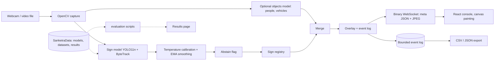

# Architecture

Components: backend (API, engine, events, registry, settings), vision (corruptions, calibration, temporal, drawing, paths), training (dataset preparation, GTSDB adapter, training), evaluation (detection report, latency, calibration, robustness, temporal), frontend (Home, Console, Perception Lab, Results, Signs).
Detection finds boxes; classification labels a crop (here the detector also classifies the group); tracking keeps identities; interpretation maps a class to registry meaning. The sign model is the only source of sign claims.
Data flow rule: code lives in the project folder (replaceable); your models, datasets, results and uploads live in SanketraData (persistent).
